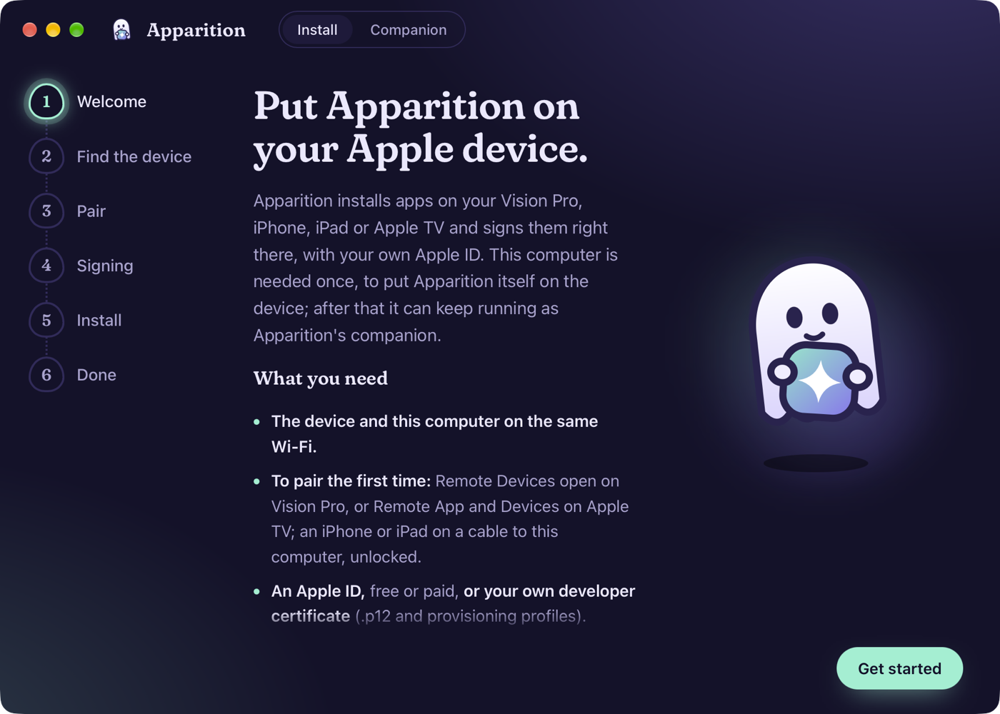
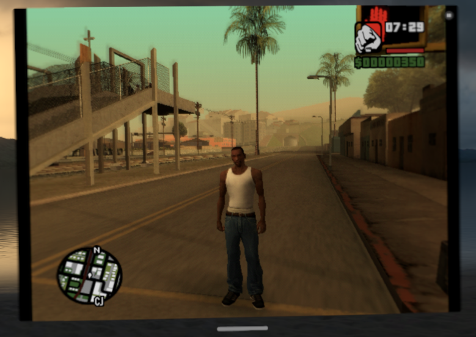

# Apparition

Apparition is a sideloader that runs on the device itself. Install apps from AltStore-format
sources on Apple Vision Pro, iPhone, iPad or Apple TV, sign them with your own Apple ID (a free
one works) or your own certificate, keep them refreshed, and launch them with JIT for emulators
such as UTM. A computer puts Apparition on the device the first time. After that, refreshing
and JIT go either through the desktop app left running as Apparition's companion, which doesn't
need to be on the same Wi-Fi (Tailscale works), or through LocalDevVPN on the device, with no
computer at all.

  
  

## What it does

- **Install apps** from AltStore and SideStore sources, from a GitHub project's releases
  (`github:owner/repo`), or from an IPA you have.
- **Sign** with a free Apple ID, which Apple limits to apps that last 7 days and two
  certificates, or with a paid account's certificate and profile, which last a year and need no
  sign-in.
- **Refresh** apps before they expire, on the device: from the app, a Shortcuts automation or
  in the background, through the companion or LocalDevVPN.
- **JIT that works on current chips.** iOS 26 on A15 and M2 and later, and visionOS 27 on
  Vision Pro, no longer let an app run code it generates just because a debugger attached once
  and set `CS_DEBUGGED`. That old trick is what SideStore's JIT button still does, and why JIT
  on Vision Pro looked impossible. **Launch with JIT** keeps the debugger attached and prepares
  the memory the app asks for, on the device itself: ARMSX2's 305 MiB took about two seconds.
  It speaks the JIT26 requests StikDebug defined (and UTM's own), so apps built for them work as
  they are, at home or away from it through the companion. Tested on Vision Pro with UTM (an
  Alpine VM) and ARMSX2, the PS2 emulator, running GTA San Andreas
  ([video](https://youtu.be/mNR0ik2QfEY)).

  
- **Pair once, then work over Wi-Fi.** Vision Pro and Apple TV pair over Wi-Fi with the code
  they show in Settings, no cable or Developer Strap. An iPhone or iPad pairs over a USB cable
  the first time (it has no pairing code); after that it's reached over Wi-Fi.
- **Share one certificate** between your devices and computers, sealed under five words, so a
  free account's two certificates go further.

## Getting started

1. Download the desktop app for macOS, Windows or Linux from
   [apparition.illixion.com](https://apparition.illixion.com) and open it. It isn't notarized,
   so on macOS move it to Applications and clear the download quarantine first:
   `xattr -dr com.apple.quarantine /Applications/Apparition.app`.
2. Pair the device, on the same Wi-Fi as the computer:
   - **Vision Pro:** open Settings > General > Remote Devices. The headset shows up in the
     desktop app; pick it and type the code the headset shows.
   - **Apple TV:** open Settings > Remotes and Devices > Remote App and Devices, and pair the
     same way. The TV asks for a code twice: once for the computer, once for Apparition's own
     pairing, which the desktop app hands over at install.
   - **iPhone or iPad:** plug it into the computer with a USB cable and unlock it, then tap
     Trust and enter its passcode if it asks. There's no code to type. You only need the cable
     this once; if the device already syncs with your Mac over Wi-Fi, that works too.
3. Sign in with your Apple ID, or choose your own certificate and profile, and install.
   Apparition opens on the device ready to sign: the desktop app hands it the pairing and the
   signing it used.
4. If the device won't open Apparition, it needs one of two settings. Turn on Developer Mode
   under Settings > Privacy & Security, which restarts the device. Or, if it says the developer
   isn't trusted, trust it under Settings > General > VPN & Device Management.
5. Leave the desktop app running if you like: as the companion, it keeps refreshing and JIT
   working while the device is away from home (see How it works).

The command line, `apparition`, does the same from a terminal; see [Installing Apparition from a
computer](#installing-apparition-from-a-computer).

**About Apple IDs.** Use a spare Apple ID for sideloading if you can. Apparition never stores
the password unless you turn on Remember password on the device, where it stays in the Keychain,
and it sends it only to Apple. The first sign-in from a computer or device Apple hasn't seen asks
for the code Apple sends to your other devices. Since 12 October 2026 Apple checks the
"anisette" data that comes with a sign-in more strictly; see [Anisette](#anisette) for what that
means and how Apparition handles it.

A free Apple ID has two development certificates. When both are taken, Apparition lists them
and revokes one only after you confirm. Apple doesn't always free the slot right away: after a
revoke it can keep refusing a new certificate ("Maximum number of certificates reached") with
only one listed, possibly because it counts a certificate that free accounts can't list. If so,
try again later, or use the certificate you already have by sharing it from another device
(Share Signing in Apparition's Settings).

## Away from home, over Tailscale

Apparition's companion works over [Tailscale](https://tailscale.com), so a computer left at
home keeps signing and refreshing apps, and launching them with JIT, wherever the device is.
Doing this alongside Tailscale is the new part: AltStore needs its computer on the same Wi-Fi,
and SideStore and StikDebug need LocalDevVPN, which takes the device's only VPN slot.

New to Tailscale? It puts your devices on one private network wherever they are, free for
personal use, with nothing to open on your router. The same network reaches a Mac's Screen
Sharing or a game streaming PC from anywhere, for example with
[Longwave](https://longwave.pro), a remote desktop app for Vision Pro, iPhone and iPad.

1. Install Tailscale on the computer that runs the desktop app, and on the device (the
   Tailscale app from the App Store), signed in to the same tailnet. Leave the desktop app
   running on that computer.
2. In Apparition on the device, open Setup > Companion and, under "Or type its address", enter
   the computer's Tailscale address with port 49160 (`100.x.y.z:49160`, shown in Tailscale's
   menu on the computer), then Use and Check. Bonjour doesn't cross Tailscale, so Find
   companion only finds it at home.
3. Under Anisette, choose Use Companion's Anisette: Apparition reaches it at the same Tailscale
   address, so signing in works away from home too.
4. Keep Tailscale connected on the device when a refresh or a Shortcuts automation runs.
   Tailscale takes the VPN slot LocalDevVPN would, and doesn't need to share it: the companion
   replaces LocalDevVPN.

Only encrypted traffic crosses the companion, and it only connects back to the device that
asked. If a Windows or Linux companion doesn't answer over Tailscale while it does at home, its
firewall is blocking the Tailscale network: allow TCP 49160 and 6969 there too (see How it
works).

## How it works

Sources are AltStore/SideStore JSON, or `github:owner/repo` for apps published only as
release assets (UTM's visionOS build).
Installed apps keep their IPA in Documents/apps, so a refresh re-signs and reinstalls
without the network, and their data survives. With "Remember password" on, the password
stays in this device's Keychain, and a refresh can sign in with nobody present (Apple
skips 2FA for a device it already trusts). Background tasks ask to run this about every
12 hours: a short app-refresh task, and a processing task for refreshes that outlast its
~30 s (uploading UTM takes 40 to 150 s). They need the companion or LocalDevVPN, and their
firing is not verified yet (`scheduleBackgroundRefresh` is the test hook).

The companion replaces LocalDevVPN: the headset resets connections it makes to its own
RemotePairing service, so Apparition asks a companion on a computer (TCP 49160) to connect
back to it. The headset then sees the connection coming from that computer. The companion
only ever connects back to the address that asked, and it carries only ciphertext
(pair-verify, then TLS-PSK) with no keys. With the headset on Tailscale, which LocalDevVPN no
longer occupies, a companion at home keeps signing and JIT working from anywhere. Tested
2026-10-11 with LocalDevVPN off: tunnel, refresh (109 s over the LAN, 150 s over Tailscale)
and JIT launch. On the LAN, Apparition finds the companion over mDNS ("Find companion"); over
Tailscale, type its address. The companion is the desktop app, which keeps it running from
the menu bar or tray, or `apparition relay` on the command line (see below); both run
`core/src/companion.rs`.

Windows asks to allow the companion through its firewall the first time it starts from a
desktop session; elsewhere allow inbound TCP 49160 (and 6969 to offer anisette), e.g. from an
elevated PowerShell: `New-NetFirewallRule -DisplayName "Apparition" -Direction Inbound
-Protocol TCP -LocalPort 49160,6969 -Action Allow -Profile Private`. On Linux, open the same
ports if a firewall runs (`sudo ufw allow 49160,6969/tcp`, or firewalld's `--add-port`), and
UDP 5353 for mDNS. On macOS, Local Network
privacy blocks an unbundled binary's multicast, so `apparition relay` there can't advertise
itself: use the desktop app, or type the address in Apparition. `apparition browse` lists the
companions mDNS sees from a machine. (The relay protocol was tested 2026-10-11 from macOS over
Tailscale and from a Windows 11 VM on the LAN, then with the Swift and Rust companions this
app replaces.)

`Lab/` is a test app for JIT experiments, launched through the probe's `launchJIT`.
Its first experiment (2026-10-11, visionOS 27.2): bytes the debugger writes into the
app's own signed `__TEXT` keep running after it detaches, including code first run
only after the detach and a site rewritten to branch to a trampoline. Apparition serves
this through an experimental JIT26 command, `x16 = 0x4150` (copy x2 bytes from x1 to x0).

## Shortcuts automation

Background refresh is not reliable, so the dependable way to keep apps signed is a
Shortcuts automation. Apparition offers three actions: **Refresh Apps** (apps that expire
within 3 days, or all with "All Apps"; returns how many it refreshed), **Launch with JIT**
(an installed app, through the companion or LocalDevVPN) and **Open Apparition**. Each
opens Apparition and runs there, because a refresh takes 40 to 150 s. Siri knows them too:
"Refresh apps in Apparition", "Launch UTM with JIT in Apparition".

To refresh every day: Shortcuts, Automation, New Automation, Time of Day, pick a time
you are usually wearing the headset, Daily, Run Immediately, then add Apparition's
Refresh Apps action. It needs "Remember password" on and the companion (or LocalDevVPN)
reachable. Apps refreshed are reported as "Refreshed UTM; expires Oct 18"; when nothing
is due it says when the next app expires; and when nothing could be refreshed the action
fails with the reason (not signed in, companion unreachable), so the automation shows it.

## Your own developer certificate

With a paid developer account, Apparition can sign without an Apple ID (Settings > Signing):
import an Apple Development or Distribution certificate as a .p12, plus development, ad hoc or
enterprise profiles that list the headset. Apps then sign on the headset for as long as their
profile lasts, usually a year, with no sign-in, anisette server or free-account slots. A wildcard
profile keeps each app's own bundle ID, and development profiles keep Launch with JIT working.
The .p12 password is only used to open the file; the decrypted key is kept in Apparition's
container, like the free account's key.

## Releases

Releases are listed on [apparition.illixion.com](https://apparition.illixion.com) (repo
`apparition.illixion.com`, whose README has the steps). GitHub Actions builds each release's
files (`.github/workflows/release.yml`, running `scripts/package-release.sh` on macOS and native
Linux runners) and attests their provenance: `gh attestation verify <file> -R
illixion/Apparition` checks a download came from this repository's workflow. The site then
signs the files' SHA256SUMS with a key in `release-signers`, which never goes near CI. `core/src/release.rs` checks that signature against the keys compiled in,
then every download's hash, so the files can be hosted anywhere. `apparition install`
with no IPA installs the latest release this way.

## Installing Apparition from a computer

`installer/` is `apparition`, the command line for Windows, Linux and macOS: it puts
Apparition (or any IPA) on the headset without Xcode, using the same Rust core, and runs the
companion (`apparition relay`, `apparition anisette serve|up|down`):

    apparition pair       # with Settings > General > Remote Devices open; type the PIN
    apparition pair --usb # an iPhone or iPad on a cable (or Wi-Fi sync); tap Trust if it asks
    apparition install --apple-id you@example.com   # on Windows add --anisette <url>
    apparition install --p12 development.p12 --profile wildcard.mobileprovision
    apparition install Other.ipa --apple-id you@example.com --anisette http://host:6969
    apparition relay      # the companion, with this computer's anisette (not on Windows); until Ctrl-C

On Linux, `pair --usb` needs usbmuxd running. Nothing else there makes the device trust the
computer (Finder and Apple Devices do on macOS and Windows), so Apparition asks it itself and
saves the record to usbmuxd; there's no need for `idevicepair`.

Without an IPA it installs the latest signed release of Apparition (see Releases).

It pairs over the network once (the pairing is kept), signs with your own certificate or an
Apple ID, and installs. Installing Apparition also hands it what signed it, through its Files
inbox: the .p12 and profiles (it asks for the .p12's password once), or the Apple ID's
certificate key as a `.apparitionsigning` file. With the key, Apparition signs with the same
certificate as the computer once signed in to the same Apple ID, so the two use one of a free
account's two certificates instead of one each.

Between devices, and from a device back to a computer, the key goes sealed: Settings > Share
Signing in Apparition (or `apparition signing share --apple-id <email>`) writes a
`.apparitionkey` file and shows five words. Send the file any way (AirDrop, Messages, a USB
stick), open it in Apparition on the other device, or on a computer in the desktop app's
signing step or with `apparition signing import`, and type the words. The words make the key
with Argon2id (64 MiB, four passes) and the file is ChaCha20-Poly1305, so the file alone is
useless. The words come from the [EFF's short wordlist
2.0](https://www.eff.org/dice) (CC BY 3.0 US, in `core/assets/`), where each word is known by
its first three letters, so case, spacing and a mistyped ending don't matter. Apple TV has no
share sheet; it gets the key from a computer over the cable or network.

An update of an app that is open on the headset finishes when it's closed. It never revokes a
certificate: an Apple ID with no free certificate slot fails with Apple's error instead.

    cd installer && cargo build --release                                   # this machine
    cargo build --release --target x86_64-pc-windows-gnu                    # Windows, from macOS with mingw-w64

### The desktop app

`desktop/` is Apparition for macOS, Windows and Linux (Tauri v2): the same installer as a
guided app, so nobody needs a terminal, and the companion, kept running from the menu bar or
tray after the window closes (its Companion tab: the relay and its connections, the anisette
server offered to devices, opening at login). As an installer, it finds the headset over mDNS (or takes its address) and pairs with
the PIN it shows, or pairs an iPhone or iPad over its cable (like `pair --usb`), signs in to an Apple ID (asking for the 2FA code) or opens a .p12 and
profiles, installs the latest signed release (or an IPA you pick) with progress, and hands
Apparition its signing at the end. When a free account's certificate or App ID slots are full
it lists them and frees one only after you type `revoke` or `delete`. It drives the same
`apparition_core::api` as the command line and shares its pairings and Apple ID data, so a
headset paired with one is paired with both. Passwords go from the app's own fields to the
core and nowhere else. On launch it checks the release site for a newer installer and links to
it; it never replaces itself.

    cargo install tauri-cli --version '^2' --locked                         # once
    cd desktop && cargo tauri build --bundles app                           # this Mac
    cargo tauri build --target universal-apple-darwin --bundles app         # arm64 + x86_64
    cargo build --release --features custom-protocol --target x86_64-pc-windows-gnu   # Windows exe
    docker build -t apparition-desktop-linux -f ../scripts/desktop-linux.Dockerfile ../scripts
    docker run --rm -v "$PWD/..:/src" -w /src/desktop -v apparition-desktop-target:/target \
        -e CARGO_TARGET_DIR=/target apparition-desktop-linux sh -c 'mkdir -p /src/build &&
        cargo tauri build --bundles deb,appimage && cd /target/release/bundle &&
        cp appimage/*.AppImage deb/*.deb /src/build/'                       # Linux, into build/

The page is plain HTML, CSS and JavaScript in `desktop/ui/` (no npm), under a strict CSP. A
debug build opens on any step with `APPARITION_DESKTOP_PREVIEW=signing` (or `pair`, `pin`,
`usbpair`, `twofactor`, `install`, `progress`, `slots`, `done`, `companion`), can read a scratch release site with
`APPARITION_RELEASE_SITE` and `APPARITION_RELEASE_SIGNERS`, and can move the companion's ports with
`APPARITION_COMPANION_PORTS=<relay>,<anisette>`; release builds ignore all four.
`scripts/package-release.sh` puts the app in the macOS and Windows installer zips next to the
command line, and with `--linux` builds a .deb and an AppImage per architecture (Ubuntu 22.04,
so glibc 2.35 or newer). Opening the app again shows the running one, which is also the way
back to its window on a Linux desktop with no tray (niri or plain GNOME, say).

## Anisette

Signing in to Apple needs "anisette" data that identifies the computer. On macOS and Linux
(arm64 and x86_64) the installer makes its own: it fetches two libraries from Apple's CDN the first time (the ones Apple Music for
Android uses; nothing of Apple's is stored in this repository), loads them in its own process
(`core/src/anisette/`) and talks to Apple through them. Nothing to run or install. On Windows, and
wherever you prefer it, use a server: Apparition ships none, so enter the URL of
any anisette-v3 server, or self-host one with `docker compose -f selfhost/anisette/compose.yaml
up -d` (Dadoum's anisette-v3-server, pulled from its own registry and pinned by
digest), and enter `http://<host>:6969`. The server sees this device's anisette identity
and IP address, never the Apple ID or password, which go straight to Apple.

**Since 12 October 2026 Apple checks that the anisette matches the device the sign-in claims
to be**, and refuses the sign-in (`-80045`, "This action cannot be completed at this time")
when it doesn't. isideload, like most sideloaders, claimed a Mac while sending the Android
libraries' anisette. Apparition claims Android for that anisette (`core/src/claimed_platform.rs`),
which Apple accepts, with one difference: a sign-in claiming Android gets no 2FA step, and no
Xcode token until the code Apple pushes to your trusted devices is checked, so Apparition asks
for that code once the password is accepted (`core/vendor/isideload`, `code_after_login`). Any
anisette-v3 server works this way, since they run the same libraries.

On a Mac the built-in provider asks macOS for the Mac's own anisette instead, and the sign-in
claims a Mac and goes through the usual 2FA (`core/src/anisette/native.rs`):

- **macOS 26 and earlier:** AOSKit gives it to any program.
- **macOS 27:** only programs with AuthKit's private entitlements get it. The release ships
  `apparition-anisette-helper` signed with them, next to `apparition` and inside the app, and
  macOS runs it only with SIP off and `sudo nvram boot-args="amfi_get_out_of_my_way=1"`.
  Otherwise the Android libraries are used, as on Linux.

Provisioning goes through the Android libraries either way, so a device's stored identity works
with any server. With a paid developer account there is also a route with no sign-in at all:
make the certificate and a wildcard or single-App-ID profile on Apple's developer website and
sign with them (`--p12 … --profile …`, or the app's Signing screen).

Release builds aren't notarized, so the built-in provider needs no entitlement today. It maps
the libraries into memory and makes them executable itself, so if the macOS apps are ever
notarized (hardened runtime), their entitlements must include
`com.apple.security.cs.allow-unsigned-executable-memory`, or loading fails.

The companion can offer the headset an anisette server too: this computer's own (built in,
served to the network on port 6969), or the same compose file run with your Docker (Docker
Desktop, OrbStack or Colima), from the desktop app's Companion tab or `apparition relay
--anisette builtin|local`. It then advertises the server, and Apparition offers "Use its
anisette server" next to the companion; nothing switches on its own.

## Build

    scripts/build-core.sh      # builds the Rust core (isideload + idevice) for visionOS and iOS
    scripts/build-core.sh visionos-sim   # adds the visionOS simulator (rustup target add aarch64-apple-visionos-sim)
    xcodegen                   # generates Apparition.xcodeproj from project.yml
    build-and-sign             # or open Apparition.xcodeproj and Run
    SCHEME_NAME=ApparitionLab TARGET_NAME=ApparitionLab BUILD_BUNDLE_ID=com.illixion.apparition.lab \
        build-and-sign --no-mcp    # the lab app

Licensed MIT. Signing (`core/signer`) builds on [apple-codesign](https://github.com/indygreg/apple-platform-rs)
(MPL-2.0), used unmodified from crates.io.
