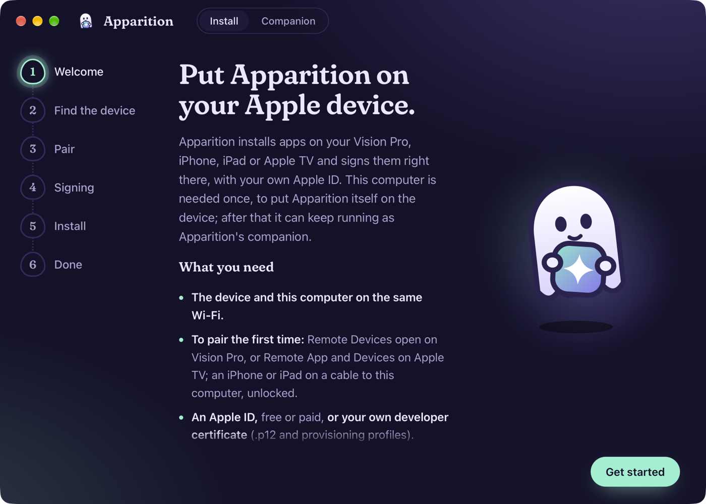
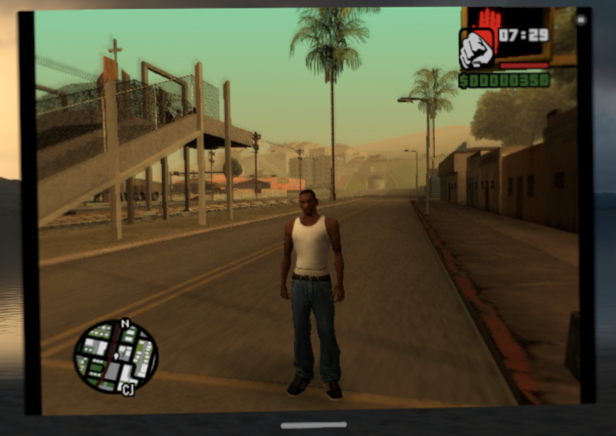

<p align="center"></p>

# Apparition

Apparition is an on-device developer tool for Apple Vision Pro, iPhone, iPad and Apple TV. It keeps
the apps you sideload with your own free Apple ID signed and running past Apple's seven-day limit
without a cable or a trip back to your desk, and it launches them with JIT for emulators such as
UTM. Your Mac is Apparition's companion for the Apple ID work: it signs in and provides anisette
from macOS itself, over the network, and needn't be on the same Wi-Fi (Tailscale works). Apps
install from AltStore-format sources, from a GitHub project's releases, or from an IPA you have,
signed with a free Apple ID or your own certificate. A computer installs Apparition on the device
the first time; after that, refreshing and JIT run on the device, reaching your Mac only when the
Apple ID work needs it.

<p align="center">
  
</p>

## Requirements

**Apparition works best with a Mac you own**, at home or reached over Tailscale. The Mac does
two jobs that nothing else can, and everything else works without one:

| What | Needs | Without a Mac |
|---|---|---|
| Signing with a free Apple ID | A Mac's anisette: your Mac, a macOS VM on it, or a server backed by a Mac | A paid account's certificate and profile, which need no sign-in |
| Building your own apps with Xcode, and live patching (`inject`) | A Mac with Xcode | [xtool](https://github.com/xtool-org/xtool) builds on Linux, and on Windows through WSL; `apparition deploy` installs it and `apparition mcp` debugs it from the PC ([how](docs/REMOTE_DEVELOPER.md#without-a-mac-xtool-on-windows-or-linux)) |
| Installing, refreshing, JIT, the companion | Nothing in particular | Any computer (macOS, Windows, Linux), or the device itself with LocalDevVPN |

With a Mac, the rest of your work can happen on it or on a Windows or Linux PC: the PC pairs with
the Mac, its agents drive your apps' debug servers through the Mac, and its builds go to your
devices through it ([remote development](docs/REMOTE_DEVELOPER.md)).

**Signing with a free Apple ID needs a Mac.** Apple gives the developer
access that signing needs only to a sign-in with a Mac's anisette, so Apparition gets it from
macOS on your own Mac, as Xcode does. That Mac is either

- your Mac on **macOS 26 or earlier**, which needs no setup, or
- a **macOS virtual machine** on your Mac ([how](selfhost/macos-vm/README.md)), which is the way on
  macOS 27, where macOS keeps its anisette to itself.

Windows and Linux computers, and devices away from home, pair with that Mac for it over an
encrypted channel. Apparition doesn't provide anisette, and doesn't run Apple code made for other
platforms to stand in for a Mac. An anisette server you give by address works only when a Mac is
behind it: Apple refuses developer access to any other (`-80046`), so a public anisette server
won't sign apps. Without a Mac, only a paid developer account's own certificate and profile sign
apps (they need no sign-in). The Apple ID is yours too: use a spare one for sideloading if you
can.

**JIT needs no particular computer.** Apparition on the device is the app's debugger. It only
needs a way back to the device's own services, which the device won't connect to directly: a
companion on any computer (macOS, Windows or Linux) bounces that connection back, or LocalDevVPN
on iPhone, iPad and Vision Pro does it with no computer (it takes the device's only VPN slot, so
not alongside Tailscale). Apple TV has no VPN app, so it uses a companion. A computer is needed
once, to install Apparition.

## What it does

- **Install apps** from AltStore and SideStore sources, from a GitHub project's releases
  (`github:owner/repo`), or from an IPA you have. Apps published as a `.deb` package, as Kodi's
  are, install the same way: Apparition unpacks the app from the package. On the device itself,
  download the `.ipa` or `.deb` in Safari and share it to Apparition (or open it from Files,
  or use Library > Install from a File): it names the app and asks before installing. A link like
  `apparition://source?url=https%3A%2F%2Fexample.com%2Fsource.json` opens Add Source with the
  source filled in, ready to add, for a source's own "Add to Apparition" button.
- **Sign** with a free Apple ID, which Apple limits to apps that last 7 days and two
  certificates, or with a paid account's certificate and profile, which last a year and need no
  sign-in. An app that asks for the increased memory limit (UTM, emulators) gets it, with a
  free account too; extended virtual addressing needs a paid account.
- **Refresh** apps before they expire, on the device: from the app, a Shortcuts automation or
  in the background, through the companion or LocalDevVPN.
- **JIT that works on current chips.** iOS 26 on A15 and M2 and later, and visionOS 27 on
  Vision Pro, no longer let an app run code it generates just because a debugger attached once
  and set `CS_DEBUGGED`. That old trick is what SideStore's JIT button still does, and why JIT
  on Vision Pro looked impossible. **Launch with JIT** keeps the debugger attached and prepares
  the memory the app asks for, on the device itself: ARMSX2's 305 MiB took about two seconds.
  It speaks the JIT26 requests StikDebug defined (and UTM's own), so apps built for them work as
  they are, at home or away from it through the companion. An app can also ask for JIT for
  itself while it runs, with an `apparition://enable-jit?bundle-id=…&pid=…` link (the
  `stikdebug://` link works too, so Madeira's Enable JIT button finds Apparition); Apparition
  then stays its debugger until the app closes. A link without a `pid` launches the app anew
  under the debugger, as StikDebug does. One with a StikDebug JIT script (`script-data`, as
  LiveContainer sends) runs the script as the app's debugger, after asking you: a script can
  read and change everything in the app. On iPhone and iPad it keeps running in the
  background by keeping coarse location updates on, which it drops unread: allow location
  while using the app when asked. From a computer,
  `apparition jit <bundle ID> [--attach]` does the same, and `apparition launch <bundle ID>
  --jit --console` launches with JIT, the app's console and environment variables in one go,
  which is how the [Apparition Store](https://github.com/illixion/Apparition/tree/main/store) build service's **JIT**
  deploy option and `build-and-sign --jit` launch a fresh build. Tested on Vision Pro with UTM (an
  Alpine VM) and ARMSX2, the PS2 emulator, running GTA San Andreas
  ([video](https://youtu.be/mNR0ik2QfEY)).

  
- **Pair once, then work over Wi-Fi.** Vision Pro and Apple TV pair over Wi-Fi with the code
  they show in Settings, no cable or Developer Strap. An iPhone or iPad pairs over a USB cable
  the first time (it has no pairing code); after that it's reached over Wi-Fi. Apparition keeps
  a copy of its pairing in the device's Keychain, so reinstalling it doesn't unpair it.
- **Share one certificate** between your devices and computers, so a free account's two
  certificates never run out one per device: nearby over the network, checked by a six-digit
  code both screens show, or as a file sealed under five words. Signing stops and asks before
  it would make a second.
- **Export the certificate as a .p12** for an app that signs with one, such as
  [LiveContainer](docs/SUPPORTED_APPS.md#livecontainer), which then runs any number of apps under
  a single App ID. See [For other apps](#for-other-apps-a-p12).

## Getting started

1. Download the desktop app for macOS, Windows or Linux from
   [apparition.illixion.com](https://apparition.illixion.com) and open it. It isn't notarized,
   so on macOS move it to Applications and clear the download quarantine first:
   `xattr -dr com.apple.quarantine /Applications/Apparition.app`.
2. Pair the device, on the same Wi-Fi as the computer:
   - **Vision Pro:** open Settings > General > Remote Devices. The headset shows up in the
     desktop app; pick it and type the code the headset shows.
   - **Apple TV:** open Settings > Remotes and Devices > Remote App and Devices, and pair the
     same way. The TV asks for a code twice: once for the computer, once for Apparition's own
     pairing, which the desktop app hands over at install.
   - **iPhone or iPad:** plug it into the computer with a USB cable and unlock it, then tap
     Trust and enter its passcode if it asks. There's no code to type. You only need the cable
     until the device trusts the computer: after that, pairing it again works over Wi-Fi.
3. Sign in with your Apple ID, or choose your own certificate and profile, and install. On a
   Mac on macOS 26 or earlier the anisette is the Mac's own; elsewhere choose From my paired
   Mac and pair with your Mac's Apparition first (see [Requirements](#requirements)).
   Apparition opens on the device ready to sign: the desktop app hands it the pairing and the
   signing it used.
4. If the device won't open Apparition, it needs one of two settings. Turn on Developer Mode
   under Settings > Privacy & Security, which restarts the device. Or, if it says the developer
   isn't trusted, trust it under Settings > General > VPN & Device Management.
5. Leave the desktop app running if you like: as the companion, it keeps refreshing and JIT
   working while the device is away from home (see How it works).

The command line, `apparition`, does the same from a terminal; see [Installing Apparition from a
computer](#installing-apparition-from-a-computer), which also says how to [put it on your
PATH](#getting-apparition-on-your-path).

**About Apple IDs.** Use a spare Apple ID for sideloading if you can. Apparition never stores
the password unless you turn on Remember password on the device, where it stays in the Keychain,
and it sends it only to Apple. The first sign-in from a computer or device Apple hasn't seen asks
for the code Apple sends to your other devices. Since 12 October 2026 Apple checks the
"anisette" data that comes with a sign-in more strictly; see [Anisette](#anisette) for what that
means and how Apparition handles it.

A free Apple ID has two development certificates. Every Apparition can sign with the same one
once it has that one's key, so the way to stay under two is to share it rather than revoke
(see [Sharing one certificate](#sharing-one-certificate)). Signing doesn't make a second
certificate while Apparition elsewhere has one: it stops and offers to get that one's key, or
to make one anyway. When both slots are taken, Apparition offers to receive another
Apparition's key first, then lists the certificates and revokes one only after you confirm.
Apple doesn't always free the slot right away: after a revoke it can keep refusing a new
certificate ("Maximum number of certificates reached") with only one listed, possibly because it
counts a certificate that free accounts can't list. If so, try again later, or share the
certificate you already have from another device.

## Developer builds and reports

The **Developer** tab, on the Mac and on devices, builds your own Xcode projects through
[Apparition Store](https://github.com/illixion/Apparition/tree/main/store), an open-source build service you run on your
Mac. **[docs/DEVELOPER.md](docs/DEVELOPER.md)** explains how the pieces fit, how to set them up
and what each part of the screen does; this section is the reference.

**From Windows, Linux or another Mac**, pair that computer with your Mac for developer access
(`apparition mac pair <address>`): its agents get the Mac's MCP server with `apparition mcp`, and
builds made there (xtool, Xcode) go to your devices with `apparition deploy <app.ipa>`, over the
companion's encrypted channel at home or over Tailscale. See
**[docs/REMOTE_DEVELOPER.md](docs/REMOTE_DEVELOPER.md)**.

**On a Mac, Apparition runs the service itself.** The app carries Apparition Store
(`Contents/Resources/service`, put there by `scripts/bundle-service.sh` from the sibling
checkout's HEAD) and starts it at launch on the Mac's Node.js 18+, as its child
(`desktop/src/host.rs`): no install, no password, nothing left running after Quit. Its config
and data are in `~/Library/Application Support/Apparition/Store/` (`service.log`,
`service.pid`); `{"checkout": "<path>"}` in `host.json` there runs an Apparition Store checkout instead.
A watchdog starts it again if it exits, so `kill $(cat …/service.pid)` restarts it after an
edit. The app talks to it with a token it hands over on stdin. Its web pages are off until you
turn them on with a password (**Devices & signing › Web UI and other devices**); that password
also lets Apparition on another device connect. **Connect to another Mac** takes a service run on
its own (`node server.js` under launchd or systemd, with `node server.js set-password`): enter its
HTTPS address and password. The service needs the `apparition-service` version 1 API.

**Console** on a running app (Reports › Running apps, this Mac's service) opens the service's
Debug console in its own window: live log, tuning panels (sliders for `DebugTunables` values and
panels an agent built), profiler and memory view. A one-time link signs it in, web UI on or off;
the window has no access to the app.

The tab has four sections: **Projects**, **Activity** (the build queue and logs), **Reports**
(crash logs, traces and, on the Mac, running debug apps, grouped by app) and **Devices &
signing** (**Service** on a device). Each project lists its targets, one per device it installs
on, with what the Mac installed there and whether the device is reachable; each target has
**Install on _device_**, **Build only** and **Re-sign…**. Launch, debug access, live patching
and Debug configuration are the project's **Build options**. The device list leaves out
simulators. New builds offer **Build details** and **Download**:
the saved artifact is checked against its manifest's SHA-256 and size before replacing
your chosen destination file. Each project lists its **kept builds**; **Other kept builds**
shows artifacts no project claims, such as Xcode products registered by hand. Manifests record bundle identities, binary UUIDs, symbols,
toolchain and before/after source/dependency fingerprints. Device debug access still asks
for approval on the device; connecting to the service does not grant it.

**Re-sign…** (on a target or a kept build) signs an app with another of the Mac's provisioning
profiles and installs it over the copy on a device. The device can't give an installed app back,
so the Mac signs the build it kept for that install, or, when it kept none, first builds the
target without installing it (the same build **Build only** makes) and signs that. The Mac
(`Apparition Store`, `build-and-sign --ipa --profile`) does the work; the view sends a build ID or a
project and platform, a device name, a profile ID, keep or discard data, and an optional dry run. A profile for the same App ID
updates in place and keeps the app's data. The device refuses an update to a different App ID, so
then the Mac copies Documents and Library to `~/.local/state/apparition/resign-backups`, removes the
app, installs the new signature and copies them back, checking the file count. If the new signature
won't install, it puts the previous one back with its data. Keychain items and app-group data
don't move. The backup is never deleted for you. **Check first** only tests that the data can be
reached.

Only the service address is remembered on disk. The service password field clears when
connecting; its session credential stays in Rust memory, outside the page. Disconnect
revokes that session. After quitting Apparition, connect again. This connection is separate
from the companion relay and does not share its signing credentials.

With the native build prerequisites ready, `node scripts/verify-build-service.cjs` runs a
real build-only integration check through an isolated authenticated service, then verifies
the manifest and downloaded artifact. It never installs or launches an app. It uses the
sibling Apparition Store checkout by default (`APPARITION_STORE_DIR` overrides it), keeps its
private temporary config/logs under ignored `build/`, and stops its own service afterward.

## Away from home, over Tailscale

Apparition's companion works over [Tailscale](https://tailscale.com), so a computer left at
home keeps signing and refreshing apps, and launching them with JIT, wherever the device is.
Doing this alongside Tailscale is the new part: AltStore needs its computer on the same Wi-Fi,
and SideStore and StikDebug need LocalDevVPN, which takes the device's only VPN slot.

New to Tailscale? It puts your devices on one private network wherever they are, free for
personal use, with nothing to open on your router. The same network reaches a Mac's Screen
Sharing or a game streaming PC from anywhere, for example with
[Longwave](https://longwave.pro), a remote desktop app for Vision Pro, iPhone and iPad.

1. Install Tailscale on the computer that runs the desktop app, and on the device (the
   Tailscale app from the App Store), signed in to the same tailnet. Leave the desktop app
   running on that computer.
2. Set the companion up once at home with Find Companion (or by typing either of its addresses,
   e.g. its Tailscale one, `100.x.y.z:49160`, shown in Tailscale's menu on the computer). The
   companion tells the device all its addresses, LAN and Tailscale, and a stable id. Before each
   action Apparition then picks where to reach it: a LAN address when the device is on that
   network (where it can also wake a sleeping Mac, below), the Tailscale address anywhere else.
   Nothing to switch when you leave home or come back, and before it uses another address it
   checks that the same computer answers there.
3. Under Anisette, choose Use Companion's Anisette: Apparition reaches it at the same Tailscale
   address, so signing in works away from home too. Anisette comes only from a Mac (see
   [Anisette](#anisette)): use your Mac, or a macOS VM on it, as this companion, or pair the
   device with the Mac as a second companion for signing in.
4. Keep Tailscale connected on the device when a refresh or a Shortcuts automation runs.
   Tailscale takes the VPN slot LocalDevVPN would, and doesn't need to share it: the companion
   replaces LocalDevVPN.

**A sleeping Mac wakes up for the device.** With "Wake for network access" on (System Settings >
Battery > Options, or Energy on a desktop Mac; `pmset -g` shows `womp 1`), a sleeping Mac keeps
answering on its network and wakes when a connection arrives for a port it listens on. So when
the companion doesn't answer, Apparition on the device knocks: it connects to the companion's
port at the Mac's LAN address, again and again for up to 20 seconds, until the Mac is up
(`Probe/CompanionWake.swift`; a MacBook Pro asleep answered in 8.6 seconds). It knows the Mac's
LAN addresses from the companion's own reply, so a companion saved by its Tailscale address is
knocked at home too (`CompanionRoutes` in the same file picks the address, for the relay and the
paired anisette Mac alike; Apps MCP's `followCompanion` runs that choice and says the result). It works only on the same network: Tailscale's UDP never wakes a Mac, so away
from home leave it awake. Woken this way macOS sleeps again within a minute, so the companion
holds it awake while devices use it and for three minutes after (`core/src/stay_awake.rs`, the
assertion `caffeinate -i` takes; `pmset -g assertions` shows "Apparition companion serving a
device"). A Windows or Linux PC needs a Wake-on-LAN broadcast, which iOS lets an app send only
with an entitlement Apple grants on request, so a PC companion isn't woken.

Only encrypted traffic crosses the companion, and it only connects back to the device that
asked. If a Windows or Linux companion doesn't answer over Tailscale while it does at home, its
firewall is blocking the Tailscale network: allow TCP 49160, 49161 and 49162 there too (see How
it works).

## How it works

Sources are AltStore/SideStore JSON, or `github:owner/repo` for apps published only as
release assets (UTM's visionOS build).
Installed apps keep their IPA in Documents/apps, so a refresh re-signs and reinstalls
without the network, and their data survives. With "Remember password" on, the password
stays in this device's Keychain, and a refresh can sign in with nobody present (Apple
skips 2FA for a device it already trusts). Background tasks ask to run this about every
12 hours: a short app-refresh task, and a processing task for refreshes that outlast its
~30 s (uploading UTM takes 40 to 150 s). They need the companion or LocalDevVPN, and their
firing is not verified yet (`scheduleBackgroundRefresh` is the test hook).

The companion replaces LocalDevVPN: the headset resets connections it makes to its own
RemotePairing service, so Apparition asks a companion on a computer (TCP 49160) to connect
back to it. The headset then sees the connection coming from that computer. The companion
only ever connects back to the address that asked, and it carries only ciphertext
(pair-verify, then TLS-PSK) with no keys. With the headset on Tailscale, which LocalDevVPN no
longer occupies, a companion at home keeps signing and JIT working from anywhere. Tested
2026-10-11 with LocalDevVPN off: tunnel, refresh (109 s over the LAN, 150 s over Tailscale)
and JIT launch. On the LAN, Apparition finds the companion over mDNS ("Find companion"); over
Tailscale, type its address. The companion announces itself only at IPv4 addresses a device
can use (no loopback, IPv6 or self-assigned 169.254 ones), under a host name of its own
(`apparition-<name>.local`). A device saves the companion's name with its address: when the
saved address stops answering (a new DHCP lease, another network), it finds the companion again
by name. The desktop app's "Let devices on this network find this computer" turns the
announcement off for networks you don't trust; devices then need the address typed, and ones
that already have it keep connecting. `apparition relay --no-mdns` is the same. The companion is
the desktop app, which keeps it running from
the menu bar or tray, or `apparition relay` on the command line (see below); both run
`core/src/companion.rs`.

Windows asks to allow the companion through its firewall the first time it starts from a
desktop session; elsewhere allow inbound TCP 49160, 49161 and 49162 to use the companion and its
encrypted anisette channel, e.g.
from an elevated PowerShell: `New-NetFirewallRule -DisplayName "Apparition" -Direction Inbound
-Protocol TCP -LocalPort 49160,49161,49162 -Action Allow -Profile Private`. Port 6969 stays on
the Mac's loopback and needs no rule.
On Linux, open the same ports if a firewall runs (`sudo ufw allow 49160,49161,49162/tcp`, or firewalld's `--add-port`), and
UDP 5353 for mDNS. On macOS, Local Network
privacy blocks an unbundled binary's multicast, so `apparition relay` there can't advertise
itself: use the desktop app, or type the address in Apparition. `apparition browse` lists the
companions mDNS sees from a machine. (The relay protocol was tested 2026-10-11 from macOS over
Tailscale and from a Windows 11 VM on the LAN, then with the Swift and Rust companions this
app replaces.)

`Lab/` is a test app for JIT experiments, launched through the probe's `launchJIT`.
Its first experiment (2026-10-11, visionOS 27.2): bytes the debugger writes into the
app's own signed `__TEXT` keep running after it detaches, including code first run
only after the detach and a site rewritten to branch to a trampoline. Apparition serves
this through an experimental JIT26 command, `x16 = 0x4150` (copy x2 bytes from x1 to x0).

### Developer workflow integration (in progress)

The intended product is Apparition for building, installing, running and diagnosing apps.
The `Apparition Store` Mac service supplies build jobs, artifacts and report storage; its
`build-and-sign` remains the build executor. DebugTrace stays an independent SDK. The
existing AltStore feed remains compatible, while an explicit job API will expose build
progress, errors and cancellation to Apparition. Keep the Node backend initially.

Implementation order:

1. **Establish patching limits on hardware.** Optimized entry patches, stale-inline
   controls and compiled Swift scalar/String replacements now pass on the headset.
   Next: shared app types, calling-convention and metadata handling, thread coordination
   and representative workloads. Retain signed-dylib injection while investigating.
2. **Connect the build service.** Authenticated version 1 service access, configured
   projects/devices, explicit build jobs, logs and report browsing are implemented in
   desktop Apparition. The initial device Developer tab adds service sign-in, project
   and branch selection, build-only/install jobs, logs, cancellation and registered-build
   browsing. Service passwords can be remembered in this device's Keychain, separately
   per service, for automatic reconnection. Bearer sessions stay in memory and
   authenticated requests refuse redirects. Disconnect forgets the service password.
   Desktop Apparition can also register an existing Mac checkout and its targets.
   The Library matches installed debuggable apps against configured project bundle IDs.
   Matching cards prefer the service target configured for the paired device, and use
   `UIDeviceFamily` to identify iPhone/iPad apps running in compatibility mode. They show
   project/platform, installed and retained build identity, JIT launch and report counts
   for the installed `CFBundleVersion`, and open the project's Developer page, where
   build-only, separately labelled device-install actions, re-signing and reports live. A retained build can be downloaded into Apparition's normal
   install review and signing flow without rebuilding it. Per-app automatic update
   preparation watches retained artifacts while the service refreshes, downloads a newer
   build and opens that same review; installation still requires confirmation. Crash text
   and trace text files can be opened and closed on device.
   Apps without a project match stay in Other Apps. Next: finish installation/session
   relationships and round out device-side report navigation.
   A Mac with Xcode executes Apple builds; other desktop platforms can connect to it.
   Service credentials stay separate from the existing relay.
3. **Unify build identity.** Connect projects, immutable builds, artifact digests and
   binary UUIDs to signed installations, sessions, patch history and reports. Preserve
   original and installed bundle IDs. Public build IDs now join jobs, installed-build
   ledger entries, traces and immutable symbol sets; symbols are selected by the app's
   actual binary UUIDs and retained across updates, including builds not yet deployed.
   Immutable artifact digests, binary identities, before/after source/dependency snapshots
   and verified downloads are now implemented and tested through a real service build.
   Next: remaining installation/session relationships and report patch history. Distinguish
   dirty local iterations from published builds.
4. **Add Xcode handoff.** The CLI can now retain an existing Xcode product and matching
   symbols without rebuilding or changing its signature. An optional generated XcodeGen
   scheme captures source context before building and registers the completed product.
   Keep debugger ownership explicit:
   Xcode/LLDB and Apparition must not compete for the same process. JIT preparation
   and Swift patching remain separately selectable capabilities.
5. **Close the reporting loop.** Add reviewed user submissions to Apparition, then
   connect other apps' DebugTrace reports to their exact builds. Add a portable report
   envelope for Rust/Tauri failures, build registration and scoped external submission
   credentials. Keep unverified imports separately classified. Report upload never
   grants live debug access; preserve device approvals for inspection and code changes.
6. **Consolidate packaging.** Once the connected workflows pass on real devices, move
   store/bin/build-and-sign into Apparition, manage the service from the desktop app,
   migrate configs and ledgers, and retain the existing CLI and headless web access.

Structural Swift changes need a separate approach: recreate a component with selected
state migration, or rebuild/relaunch with state restoration. Executable-memory access
alone cannot change the layout of instances that already exist. A debugger-assisted
backend must retain per-patch user approval before it becomes a product feature.

### Registering projects and Xcode builds

In desktop Apparition's Developer view, use **Register a project** to add an existing
checkout on the Mac service host. Enter its Mac path, device names, platform aliases and
bundle identifiers; its `build-signing.conf` must already be set up. Registration saves
the project without building it or changing signing material. Local branch names are
optional; the current checkout remains available. The Mac service validates the checkout
and updates its configuration atomically, preserving existing settings.

When the device build service is connected, the Library's **Your Projects** group shows the
installed debuggable apps a configured project builds, matched by bundle ID. A card offers the
newest kept build as an update (installed through Apparition's own signing and review), JIT
launch, and **Open Project**, which opens the project's page on the Developer tab with its
builds, re-signing and reports. Apps with no configured project match remain in Other Apps. The
service connection is shared with Developer.

On the Mac with the complete build-tools checkout and Node 18+:

```sh
apparition xcode register --app /path/to/Products/MyApp.app --project /path/to/repo \
  --symbols /path/to/Products/MyApp.app.dSYM
apparition xcode configure --spec project.yml --target MyApp
```

`configure` writes `project.apparition.yml` and generates a `MyApp (Apparition)` scheme.
Use that spec for subsequent XcodeGen runs; the original spec stays intact. Set
`APPARITION_CLI` if the CLI is outside PATH and `APPARITION_BUILD_TOOLS` if the tools
are outside the packaged location or the checkout behind `build-and-sign` on PATH.
The scheme performs one normal Xcode build, then retains its artifact and UUID-matched
symbols in the same registry the developer service exposes. Registration without a
pre-build context records observed source separately; it cannot establish what source
was compiled. Unsigned products remain unsigned and need signing before installation.

Registration does not install, launch or attach a debugger. Stop an Xcode debug session
before asking Apparition to own JIT for that process. This handoff does not replace the
device's approvals for live inspection or code changes.

### Optimized entry-patch experiment

The lab now runs a second experiment **before** the original experiment detaches. It
branches from an optimized compiler-generated C function to a replacement already linked
in the app, then restores the original instruction. A caller in the target's translation
unit deliberately inlines the original function. The harness is in a separate translation
unit, and the Lab target explicitly enables optimization and disables LTO.

Build and install the isolated lab, then launch it through Apparition's debugger:

```sh
xcodegen
SCHEME_NAME=ApparitionLab TARGET_NAME=ApparitionLab \
  BUILD_BUNDLE_ID=com.illixion.apparition.lab \
  ~/bin/build-and-sign --platform iOS --device AVP
apparition jit com.illixion.apparition.lab --device AVP --wait 60
xcrun devicectl device copy from --device AVP \
  --domain-type appDataContainer --domain-identifier com.illixion.apparition.lab \
  --source Documents/optimized-patch-report.json \
  --destination build/optimized-patch-report.json
```

The report records baseline/patched/restored return values, loop checksums, write results,
and five timings per phase in nanoseconds per call. Breadcrumbs are synced before risky
steps to `Documents/optimized-patch-steps.txt`. A normal launch reports `not-traced` and
does not issue debugger requests. Use a fresh launch for each experiment.

`[11,17,11]`, and the inlined caller returned `[11,11,11]`; loop checksums matched all three
phases. Tiny-function timings varied substantially, including after restoration, so they
establish no application-level performance improvement. This proves optimized entry
redirection and the stale-inline limitation. It does **not** yet demonstrate Swift-native
patching, dynamically generated replacement code, arbitrary type changes, or an alternative
to DebugTrace's current injection backend. Ordinary-launch controls also remain unpatched.

### Native Swift entry-patch experiment

The lab also tests optimized native Swift entries with a separately compiled, development-
signed dylib delivered into its Documents directory after the app build. It runs before the
C experiments detach the debugger. Only the dylib's address getters have a C ABI; patched
functions use Swift's native calling convention, without `-enable-implicit-dynamic` or
`@_dynamicReplacement`.

```sh
python3 scripts/run-swift-entry-lab.py --platform visionOS --device AVP
# For a paired iPhone instead:
python3 scripts/run-swift-entry-lab.py --platform iOS --device ixPhone
```

The runner builds and installs only `com.illixion.apparition.lab`, compiles and signs the
replacement, copies it to the device, launches through Apparition JIT, and validates both
the patched run and an ordinary-launch control. `--skip-build` reuses an already installed
lab of the selected platform. It overwrites the device report with a pending marker before
each launch, so a crash cannot reuse an old success. Reports stay under ignored
`build/swift-entry-lab/<platform>/`. Runtime checkpoints are in
`Documents/swift-entry-steps.txt`.


- A native Swift integer entry returned `[11,17,11]` before patching, after patching and
  after restoration. Both a Swift function reference and a normal compiled Swift call
  observed the replacement. The latter reads an opaque runtime input on every call to
  prevent constant specialization and reuse of a pure function's earlier result.
- A native `String -> String` entry returned `original:hello`, `replacement:hello`, then
  `original:hello`. All 1,000 heap-backed String calls matched the replacement result.
- All entry/island writes and restorations succeeded. The native visionOS replacement
  was 155,582,456 bytes away, beyond a direct ARM64 branch's range: a reserved nearby
  island successfully redirected the entry through an absolute jump.
- An ordinary launch returned original results without sending any debugger requests.

This is a single-threaded, ARM64 lab proof using signed dylib loading. It has no general
function discovery or dependency tracking, does not allocate anonymous JIT code, and does
not test custom app types, generics, async/throwing methods, pointer authentication, active
stack frames or concurrent patch publication. Existing inlined or constant-folded results
can still retain old behavior. Keep the dylib loaded for the process lifetime. The experimental Developer/CLI backend now uses explicit non-optimized boundaries,
all-stop publication, image/instruction validation, and the same device approval as
DebugTrace injection; see [the developer workflow](docs/DEVELOPER.md#live-patches-from-developer-or-the-cli).
General optimized functions, caller dependency tracking and automatic type migration remain
unsupported. No application performance claim follows from these correctness tests.

## What refreshes when

Every re-sign is a round of requests to Apple, so Apparition only does one for an app that
needs it, and "needs it" is one number: 3 days or less left. The Library's **Refresh
Expiring** button, the background runs and Shortcuts' Refresh Apps (without "All Apps") all
use it; with nothing due the button is greyed out and Apparition contacts Apple for nothing.
Asking by name ignores it: an app's own Refresh button, the Developer tab's Install update
and "Automatically install updates", and Refresh Apps with "All Apps" on.

Which apps are due is read from the stored expiry dates, so the Library shows "N apps due for
refresh" and tints their pills orange without asking anyone.

Apparition contacts external servers only when you ask. Check for Update on its card asks the
release site, Reload Sources in Browse fetches the sources, and the Refresh Apps shortcut has a
**Check for Updates** option that does both for what is installed, at the same time as the
signing: the release site, and only the sources your installed apps came from. Off by default.
Nothing fetches any of them in the background, and the Library opens without a request.

When one of those checks finds an update, Apparition posts one quiet notification (no sound, in
the notification list) for it, and says nothing more about that update on later checks. Settings,
Notifications turns it off.

## Permission prompts

Apparition asks for three things, each when it first needs it, and none of them has a reason
beyond what its text says (the strings live in `project.yml`):

- **Local Network**, when it first looks for this device's developer services, a companion or
  a nearby device with a signing key, or connects to the build service you set up.
- **Location** (iOS only), the first time it becomes an app's JIT debugger. It is needed to keep
  Apparition running in the background while it serves JIT, and the updates are dropped unread,
  never stored or sent. visionOS keeps it running with silent audio and asks for nothing.
- **Notifications** (alerts only, never sound), at first launch, so the first update a Shortcuts
  run finds can be announced without a prompt nobody sees. Skipped if Settings, Notifications is
  off, and asked when you turn that on.

At first launch Apparition asks for Local Network and Notifications. It uses no camera,
microphone, photos, contacts or Face ID.

## Shortcuts automation

Background refresh is not reliable, so the dependable way to keep apps signed is a
Shortcuts automation. Apparition offers three actions: **Refresh Apps** (apps that expire
within 3 days, or all with "All Apps", and optionally checking for updates; returns how many it refreshed), **Launch with JIT**
(an installed app, through the companion or LocalDevVPN) and **Open Apparition**. Each
opens Apparition and runs there, because a refresh takes 40 to 150 s. Siri knows them too:
"Refresh apps in Apparition", "Launch UTM with JIT in Apparition".

To refresh every day: Shortcuts, Automation, New Automation, Time of Day, pick a time
you are usually wearing the headset, Daily, Run Immediately, then add Apparition's
Refresh Apps action. It needs "Remember password" on and the companion (or LocalDevVPN)
reachable. Apps refreshed are reported as "Refreshed UTM; expires Oct 18"; when nothing
is due it says when the next app expires; and when nothing could be refreshed the action
fails with the reason (not signed in, companion unreachable), so the automation shows it.

## Your own developer certificate

With a paid developer account, Apparition can sign without an Apple ID (Settings > Your
Certificates > Certificates & Profiles). That screen is separate from the Apple ID's and works
offline: it never signs in or contacts Apple, and the Apple ID's own Certificates & App IDs
screen (Settings > Apple ID) asks Apple only when you press Load from Apple. Import an Apple Development or Distribution certificate as a .p12, plus development, ad hoc or
enterprise profiles that list the headset. Apps then sign on the headset for as long as their
profile lasts, usually a year, with no sign-in, anisette server or free-account slots. A wildcard
profile keeps each app's own bundle ID, and development profiles keep Launch with JIT working.
The .p12 password is only used to open the file; the decrypted key is kept in Apparition's
container, like the free account's key.

### Both an Apple ID and a certificate

With an Apple ID and an imported certificate (a free account for trying apps out, a paid team
for keeping them), Apparition asks what signs a new app before its first install: Install in
Browse, or an .ipa you open. It also lists a copy of the app that another team signed, if the
headset has one. A copy signed by another team can't be replaced, so the choice has to come first.
The Apple ID adds its team ID to the bundle ID and a certificate keeps it, so the two kinds
install side by side with data of their own. Where a certificate from another team would need the
same bundle ID, Apparition says so before installing, rather than passing on installd's error.

Changing an app's signer later (its menu in the Library) changes its bundle ID too, as does an
Apple ID that signs for another team. The app comes back as a new copy; Apparition then copies
the old copy's files to it through the same tunnel (house_arrest), and removes the old copy only
once every file arrived. Turn it off in Settings > Certificates & Profiles. Caches are left behind, and so are
Keychain items and app group data, which belong to the signing team. Only a development-signed
app can have its data read, so a distribution-signed one keeps its data in the old copy.

## Releases

Releases are listed on [apparition.illixion.com](https://apparition.illixion.com) (repo
`apparition.illixion.com`, whose README has the steps). GitHub Actions builds each release's
files (`.github/workflows/release.yml`, running `scripts/package-release.sh` on macOS and native
Linux runners) and attests their provenance: `gh attestation verify <file> -R
illixion/Apparition` checks a download came from this repository's workflow. The site then
signs the files' SHA256SUMS with a key in `release-signers`, which never goes near CI. `core/src/release.rs` checks that signature against the keys compiled in,
then every download's hash, so the files can be hosted anywhere. `apparition install`
with no IPA installs the latest release this way.

## Installing Apparition from a computer

`installer/` is `apparition`, the command line for Windows, Linux and macOS: it puts
Apparition (or any IPA) on the headset without Xcode, using the same Rust core, and runs the
companion (`apparition relay`) and pairs with a Mac for anisette (`apparition anisette pair`):

    apparition pair       # with Settings > General > Remote Devices open; type the PIN
    apparition pair --usb # an iPhone or iPad: a cable until it trusts this computer, then Wi-Fi works too
    apparition pairing hand-off   # give an Apparition already installed there its pairing
    apparition apps --device ATV --json   # what it has installed, with versions; never wakes a sleeping Apple TV
    apparition push App-signed.ipa --device ATV   # install an IPA already signed for the device, as it is
    apparition container pull com.example.app --device ATV backup/   # its Documents and Library; `push` puts them back, `count` counts
    apparition uninstall com.example.app --device ATV
    apparition launch com.example.app --device ATV --console   # launch, streaming its stdout/stderr here
    apparition launch com.example.emu --device AVP --jit --console   # launch suspended and serve its JIT requests
    apparition anisette pair my-mac.local   # Windows, Linux, macOS 27: once, for a Mac's anisette
    apparition install --apple-id you@example.com   # this Mac's anisette, or the paired Mac's
    apparition install --p12 development.p12 --profile wildcard.mobileprovision
    apparition install Other.ipa --apple-id you@example.com --anisette https://anisette.example
    apparition install kodi.deb --apple-id you@example.com   # a .deb package: the app inside is installed
    apparition sign UTM.ipa --apple-id you@example.com   # sign only, for a paired device; nothing installed
    apparition relay      # the companion, with this Mac's anisette on a Mac that gives it; until Ctrl-C

#### Getting `apparition` on your PATH

On a Mac the command line is inside the app (from 0.3.3), so updating the app updates
it. Run it once to put `apparition` where every terminal finds it:

    /Applications/Apparition.app/Contents/MacOS/apparition-cli link

That makes `~/.local/bin/apparition`, a symlink into the app, and says what to add to your
`PATH` if that folder isn't on it (`export PATH="$HOME/.local/bin:$PATH"` in `~/.zshrc`).
`--dir /usr/local/bin` links somewhere else (needs `sudo`) and `--remove` undoes it. The link
points at the app's location, so run `link` again if you move the app. The command inside the
app is called `apparition-cli` because a Mac treats `apparition` and the app's own `Apparition`
as one name. On Linux, `link` does the same for wherever you unpacked the tarball; on Windows, put
the folder holding `apparition-cli.exe` on your `PATH` and run `apparition-cli --version`.
The Windows command line needs a distinct name too: `apparition.exe` collides with the
desktop's `Apparition.exe` on a case-insensitive filesystem.

#### Every command

`apparition` with no arguments (or `--help`) prints the full text; this is the shape of it.

| Command | What it does |
| --- | --- |
| `devices` | Lists the devices on this network that are paired or waiting to pair. |
| `pair [<address>[:<port>]]` | Pairs with a headset or Apple TV showing its pairing screen; finds it over mDNS without an address. |
| `pair --usb [<UDID>]` | Pairs an iPhone or iPad. Despite the name, the cable is only needed until it trusts this computer; after that this works over Wi-Fi. Also makes the pairing for Apparition on the device. |
| `pairing hand-off` | Gives Apparition, already installed on an iPhone, iPad or Apple TV, its pairing with that device, without reinstalling it. |
| `install [<app.ipa or .deb>]` | Signs and installs. With no file, installs the latest Apparition, checked against the release signature. Signs with `--apple-id <email>` (anisette from this Mac or the paired Mac, or `--anisette <url>` for a server you run) or `--p12 <file> --profile <file>`. `--no-watch` leaves the app's watch app out. |
| `sign <app.ipa or .deb>` | Signs for a paired device and installs nothing; says which capabilities the app got. |
| `watches [--device <name>] [--install <signed watch .app>]` | Lists the Apple Watches paired with an iPhone, and can put an already signed watch app on them through the phone. |
| `jit <bundle ID>` | Is the app's debugger from this computer so it can use JIT: launches it, or with `--attach` takes the running process, and serves its JIT requests. |
| `certificates`, `app-ids` | Show what uses up a free account's two certificates and ten App IDs, and free one you choose after you confirm. |
| `signing receive`, `send`, `hand-off`, `share`, `import` | Move the Apple ID's certificate key between your devices and computers; see Sharing one certificate below. |
| `forget <name or UDID>` | Forgets a paired device. |
| `relay` | Is the companion for Apparition on your devices until Ctrl-C (the same as the desktop app's Companion tab), offering this Mac's anisette to paired devices and computers on a Mac that gives it. |
| `anisette pair <address>`, `status`, `forget` | Pair this computer with a Mac running the companion, for its anisette; say which anisette sign-ins use; forget the pairing. See [Anisette](#anisette). |
| `anisette serve` | Serve this Mac's own anisette on loopback, for other programs on this Mac. |
| `mac pair <address>`, `status`, `forget` | Pair this computer with your build Mac: developer access to its Apparition Store and, where it offers it, its anisette, with one approval there. See [docs/REMOTE_DEVELOPER.md](docs/REMOTE_DEVELOPER.md). |
| `deploy <app.ipa> [--device <name>] [--keep]` | Send an app built here (xtool, Xcode) to the paired Mac. With a device named, the Mac installs it itself when it can (paired with the device, certificate imported); otherwise the device's Apparition installs it. |
| `deploy-signing import <cert.p12> --profile <file>… \| list` | On the Mac: give its Store a certificate and profiles so it can sign and install what other computers send. |
| `mcp` | An MCP server on stdio for agents here: the debug servers of the apps the Mac sees, plus `deploy`. |
| `browse` | Lists the companions mDNS finds, for 10 seconds: a check that multicast works. |
| `link` | Puts `apparition` on your `PATH` (above). |

**Apple Watch apps.** An iPhone app that carries a watch app (`Watch/` inside the IPA) installs
on the paired Apple Watch too: Apparition asks the iPhone which Watch it is paired with, registers
the Watch on the team, signs the watch app with its own App ID and profile, installs the iPhone
app, and then puts the watch app on the Watch directly through the phone. iOS itself only copies a
watch app over for App Store and paid-team profiles, so a free account's watch app would never
arrive without this step. The Watch asks to trust the computer the first time (tap Trust on the
Watch); the record is kept. The watch app is one of the items in Install Options (`--no-watch`
on the command line), so it can be left off to save an App ID. Nothing on the Watch itself needs
setting up: no Wi-Fi, and the Watch stays on Bluetooth. Developer Mode was already on for the
Watch this was tested with, so whether a Watch without it accepts the install is not known.

A bare watchOS IPA, whose main app is the Watch app itself (the `-watchOS.ipa` the Apparition Store
builds), goes only to the Watch, through the iPhone, and nothing is installed on the phone. With
your own certificate, the watch app's profile has to list the Watch's UDID as well as the
iPhone's, or the Watch refuses it. Apparition on the iPhone itself does the same for an app with
a watch app; it keeps which Watch got it.

Removing an app from the native Library (Remove App) deletes it and its data from the device and
its watch app from the Watch it was put on, then drops the library entry whatever those steps
did: a device that can't be reached never leaves an app stuck in the list, and what could not be
removed is listed. Apps installed before this release have no record of their Watch copy, so
that one is left for you to delete. Data takeover between App IDs moves the iPhone's container
only; a watch app's data is not moved.

Anything that signs in asks for the Apple ID's password, and for the 2FA code when Apple sends
one, in the terminal; neither is kept unless you turn on Remember password on the device.
`APPARITION_LOG=<file>` writes the sign-in's progress (no secrets) to a file, for working out
why a sign-in failed.

On Linux, `pair --usb` needs usbmuxd running. Nothing else there makes the device trust the
computer (Finder and Apple Devices do on macOS and Windows), so Apparition asks it itself and
saves the record to usbmuxd; there's no need for `idevicepair`.

Without an IPA it installs the latest signed release of Apparition (see Releases).

It pairs over the network once (the pairing is kept), signs with your own certificate or an
Apple ID, and installs. Installing Apparition also hands it what signed it, through its Files
inbox: the .p12 and profiles (it asks for the .p12's password once), or the Apple ID's
certificate key as a `.apparitionsigning` file. With the key, Apparition signs with the same
certificate as the computer once signed in to the same Apple ID, so the two use one of a free
account's two certificates instead of one each. For an Apparition installed some other way,
`apparition signing hand-off --apple-id <email> [--device <name>]` puts the key in its inbox on
its own. `apparition signing hand-off --build-signing [<dir>]` does the same for `build-and-sign`'s
signing: every `.p12` under `~/.config/build-signing/certs` and `.mobileprovision` under `profiles`,
sent into Documents/Signing over the device's pairing, so the headset can sign what the Apparition Store
builds without a reinstall (`--p12 <file>... --profile <file>...` sends files you name). The
Developer view's **Signing on devices** does it with a button. Apparition on the device asks for
each .p12's password once; the passwords are never sent.

#### When Apparition says it isn't paired

Apparition reaches the device it runs on with a pairing of its own,
`apparition_rp_pairing.plist` in its Documents folder. On Vision Pro it makes that itself in
Setup. On iPhone, iPad and Apple TV it gets it from the computer that paired the device:
installing Apparition hands it over. Anything that needs the device (an install, a refresh, a
JIT request from an app such as Madeira) stops at once and says which of two things is wrong:

- **Apparition isn't paired.** The file is missing, for example after Apparition was deleted
  and installed again some other way. Apparition keeps a copy in the Keychain (this device
  only, never synced) and puts the file back from it at launch, so this only happens when that
  copy is gone too (it was never made, or the new copy is signed by another team). On iPhone or
  iPad, from a computer that trusts the device, run

      apparition pair --usb
      apparition pairing hand-off [--device <name>]

  Wi-Fi is enough; the cable is only needed while the device doesn't trust the computer. On an
  Apple TV, run `apparition pair` with Remote App and Devices open (it shows a code twice), then
  `pairing hand-off`. On Vision Pro, pair again in Setup.
- **The device no longer trusts Apparition's pairing.** The file is there, but the device turns
  it down, for example after the device was erased or its trust settings were reset. Pair
  again the same way.

Settings > Forget Pairing deletes both the file and the Keychain copy.

#### Sharing one certificate

Between devices, and from a device back to a computer, the key goes one of two ways.

**Nearby**, on the same network. On the device that needs it, Settings > Get Signing from
Another Device (or Get It from Another Device where signing stopped) waits for it; so do
`apparition signing receive` and the desktop app's Receive from a Nearby Device. On the one
that has it, Settings > Share Signing with Another Device lists what's waiting under Nearby;
on a computer, `apparition signing send --apple-id <email>` or the desktop app's Send to a
Nearby Device. Both screens show a six-digit code, and each person confirms that the two match.
It's numeric comparison, as Bluetooth pairing does it (core/src/nearby.rs): the sender commits
to its X25519 key before it sees the receiver's, so something in between would get two
different codes, all but one time in a million, and the key, sealed with ChaCha20-Poly1305
under the agreed key, goes only to a device whose person confirmed. Where Bonjour can't reach
(Tailscale, or a command line on macOS whose terminal has no Local Network access), type the
address the receiving screen shows (`--to <address>:<port>`). This is the way on Apple TV, which
has no AirDrop.

**As a file**, for a device on another network. Share Signing > Make a Key File in Apparition
(or `apparition signing share --apple-id <email>`) writes a `.apparitionkey` file and shows
five words. Send the file any way (AirDrop, Messages, a USB stick), open it in Apparition on
the other device, or on a computer in the desktop app's signing step or with `apparition
signing import`, and type the words. The words make the key with Argon2id (64 MiB, four
passes) and the file is ChaCha20-Poly1305, so the file alone is useless. The words come from
the [EFF's short wordlist 2.0](https://www.eff.org/dice) (CC BY 3.0 US, in `core/assets/`),
where each word is known by its first three letters, so case, spacing and a mistyped ending
don't matter.

#### For other apps: a .p12

Some apps sign other apps themselves and need a certificate with its private key:
[LiveContainer](docs/SUPPORTED_APPS.md#livecontainer)'s JIT-less mode, which iOS 26 and later
require, is the one we've tested. Settings > Share Signing with Another Device > Export
Certificate as .p12 (0.3.5 and later) writes the Apple ID's certificate and key as a `.p12`
under a password of six new words, to copy and share separately. It signs in if it has to and
makes no new certificate, so the other app signs with the one Apparition already uses. The file
is deleted when the screen closes. Anyone with the file and its password can sign apps as your
Apple ID, so give it only to an app you trust; if it gets out, revoke the certificate in
Certificates & App IDs.

An app that is open on the headset is closed before its update installs, as Xcode does, so the update applies straight away; only Apparition's update of itself waits until you close it. It never revokes a
certificate on its own: with no free slot it offers to receive another Apparition's key, then to
revoke one you choose.

    cd installer && cargo build --release          # this machine, into target/ at the root (one workspace with desktop/)
    cargo build --release --target x86_64-pc-windows-gnu                    # Windows, from macOS with mingw-w64

### The desktop app

The first time it opens, the app asks what you want to do. **Install apps** shows the install
steps and Settings. **Develop apps** adds a Develop tab (a checklist of what is ready, your
projects, builds and reports) and turns Install into Devices, where you pair a device and set up
signing. Both modes share the same pairing and signing, and the buttons in the header's corner
switch between them at any time; the choice is remembered. To add a project, choose its folder: the
Apparition Store reads its schemes and bundle IDs and writes a small `build-signing.conf` with no
signing material, kept out of Git. Settings holds the companion (a dot on the tab shows whether it
is running), anisette, opening at login and updates.

`desktop/` is Apparition for macOS, Windows and Linux (Tauri v2): the same installer as a
guided app, so nobody needs a terminal, and the companion, kept running from the menu bar or
tray after the window closes (its Settings tab: the relay and its connections, the anisette
server offered to devices, opening at login). As an installer, it finds the headset over mDNS (or takes its address) and pairs with
the PIN it shows, or pairs an iPhone or iPad over its cable (like `pair --usb`), signs in to an Apple ID (asking for the 2FA code) or opens a .p12 and
profiles, installs the latest signed release (or an IPA or .deb you pick) with progress, and hands
Apparition its signing at the end. When a free account's certificate or App ID slots are full
it lists them and frees one only after you type `revoke` or `delete`. It drives the same
`apparition_core::api` as the command line and shares its pairings and Apple ID data, so a
headset paired with one is paired with both. Passwords go from the app's own fields to the
core and nowhere else.

Desktop update checks are **off by default**, including for existing installations.
Choose automatic checks on step 6, **Done**, or with the **Companion > Updates** toggle.
When enabled, the app contacts apparition.illixion.com on launch and every six hours of
wall-clock time (a laptop that slept past a check catches up on wake), including while
running from the tray, for releases hosted on GitHub. A failed check retries after 15 minutes. When off, **Get started**
offers a one-time check without enabling future checks; declining makes no update request.
The tray/menu-bar menu has an updates section: a greyed-out **No Updates** line, which becomes
**Update to x.y.z...** when one is available, and a **Check Automatically** checkbox mirroring
the setting. A badge on the icon and a banner in every app view also announce an update;
the banner disappears once a check finds nothing newer. **Update & restart** downloads and
installs it only when clicked; the companion briefly stops while restarting. Development
builds are never replaced.

Updates use the existing GitHub Releases assets and release workflow: the pinned release
keys must verify the YubiKey-signed `SHA256SUMS` SSH signature, then the downloaded file must
match that signed hash **before it is extracted or installed**. Version, OS, architecture
and package format are bound to the signed filename; older or equal versions are refused.
An app-only release does not hide a newer desktop release.

On macOS the whole ad-hoc-signed `.app` (including its CLI and entitled anisette helper) is
staged beside the installed app, its code-signing seal is checked, and the bundles are
atomically exchanged. The Applications folder must be writable by your account; use
`~/Applications` if necessary. Updating does not re-sign the helper or require a new
quarantine exception. On Windows the portable app, `apparition-cli.exe` and
`WebView2Loader.dll` update together: a Windows PowerShell helper waits for the app to
exit, replaces the files, restarts it, and rolls back if installation or launch fails.
The helper is passed to PowerShell as a command, not a script file, so a Group Policy
execution policy doesn't block it. PowerShell locked to Constrained Language mode
(AppLocker or WDAC) does: the banner then says the computer's policy blocks the updater
and links to the Releases page for a manual download.
Keep all three in a user-writable folder. On Linux an AppImage replaces itself atomically and keeps
its executable permissions. A Debian installation instead asks for system authorization
through PolicyKit and installs the verified `.deb` with `dpkg`; it needs `pkexec` and a
desktop authorization agent. If `dpkg` reports missing dependencies, repair them with
your package manager before retrying. The unpublished Flatpak prototype has no update
repository and must still be updated manually. Settings, pairings and signing credentials
stay outside these application packages and are not replaced.

Before signing, the desktop installer and native iPhone/iPad, Vision Pro and Apple TV apps
list the IPA's embedded extensions and let you choose which to include. Apple ID installs show the number of new App IDs needed and let
you reuse an existing registration by installing under its bundle identifier. Assignments
and extension choices are saved per team, device and source app in
`app-id-assignments.json` beside the desktop's pairing database, including reservations
made before an install fails. The native apps store the same choices in `library.json`,
with the team and source identifier; Apple TV mirrors that state to its Keychain vault.
An occupied identifier replaces the app already using it, and the previous library entry
stops refreshing over its replacement. Removing a native Library entry deletes the copy and releases its ID reservations; forgetting
one whose device deletion failed keeps them while that copy is installed; a fresh device listing releases reservations
once a forgotten copy is gone. Failed replacements retain old extension reservations until
installation succeeds. These databases are local to each installation;
assignments are not synchronized between computers and devices.

Assignments are per device, so one registered App ID can serve different apps on different
devices (and platforms): the same bundle identifier can be the target of one app on a Vision Pro
and of another on an Apple TV or iPhone, and one app can get a different identifier on each
device. Apparition only looks for conflicts within one team and device. An identifier that is
occupied replaces the app using it on the device being installed to, never on another device.
Apple registers one App ID per team, not per platform, so these share its capabilities (App
Groups, for one) and its free-account limits. Because each computer keeps its own assignments,
and none of them can see what other devices or installers use, Apparition cannot warn that an
identifier is already in use somewhere else; reusing one across devices is your call.

The review asks whether to keep existing app data or uninstall the destination first.
Uninstalling discards its app container before the new install, so a failed installation
leaves the old app removed. When an app moves from a known previous identifier, Keep
copies Documents and Library using the same migration code as changing its signer on the
device. The source is removed only after every file arrives. Incomplete or queued transfers
keep the source and can be retried. Keychain items and shared app group containers cannot
be migrated or cleared by this choice. Registrations may also be used by other devices or
installers; the local assignment database cannot determine that account-wide ownership.
ExtensionKit helpers are currently unavailable with Apple ID signing; imported profiles
can still sign selected helpers when they cover them. Ordinary app extensions each need
a compatible registration; the installer reuses matching child identifiers where present.
Certificate installs preview the actual identifier chosen by the provisioning profile and
disable extensions whose profiles are missing. Both frontends check the App ID allowance
before signing. Native Library > More > **Review Install Options** reopens the picker for
a kept app, including file imports. Foreground updates review the new archive; unattended
refreshes retain the saved identity and extension selection and never add new extensions.
Changing a native app's signer requires reviewing its install options before refreshing.
Existing library records retain their previous refresh behavior until reviewed. Cancelling
a review keeps the previous archive available for refresh.

After Apple ID sign-in, **Manage App IDs** is available on the signing and install
screens. It shows Apple's remaining allowance, registered bundle identifiers and expiry
dates, with search, refresh and deletion after confirmation. Deleting an ID may not
restore a free account's weekly allowance before it expires.

    scripts/install-tauri-cli.sh      # once (or cargo install tauri-cli --version '^2' --locked)
    cd desktop && cargo tauri build --bundles app                           # this Mac
    scripts/install-desktop.sh        # build, sign, install to /Applications and relaunch (this Mac)
    cargo tauri build --target universal-apple-darwin --bundles app         # arm64 + x86_64
    cargo build --release --features custom-protocol --target x86_64-pc-windows-gnu   # Windows exe
    docker build -t apparition-desktop-linux -f ../scripts/desktop-linux.Dockerfile ../scripts
    docker run --rm -v "$PWD/..:/src" -w /src/desktop -v apparition-desktop-target:/target \
        -e CARGO_TARGET_DIR=/target apparition-desktop-linux sh -c 'mkdir -p /src/build &&
        cargo tauri build --bundles deb,appimage && cd /target/release/bundle &&
        cp appimage/*.AppImage deb/*.deb /src/build/'                       # Linux, into build/

The page is plain HTML, CSS and JavaScript in `desktop/ui/` (no npm), under a strict CSP. A
debug build opens on any step with `APPARITION_DESKTOP_PREVIEW=signing` (or `pair`, `pin`,
`usbpair`, `twofactor`, `install`, `progress`, `slots`, `done`, `companion`), can read a scratch release site with
`APPARITION_RELEASE_SITE` and `APPARITION_RELEASE_SIGNERS`, and can move the companion's ports with
`APPARITION_COMPANION_PORTS=<relay>,<anisette>`; release builds ignore all four.
`scripts/package-release.sh` puts the app in the macOS and Windows installer zips next to the
command line, and with `--linux` builds a .deb and an AppImage per architecture (Ubuntu 22.04,
so glibc 2.35 or newer). The Linux release includes direct .deb and AppImage downloads as well
as an archive with both and the headless command line. Opening the app again shows the running
one, which is also the way back to its window on a Linux desktop with no tray (niri or plain
GNOME, say).

A Flatpak prototype packages both Linux architectures against a GNOME runtime,
with the CLI included for diagnostics. See [building and testing the Flatpak](docs/LINUX_FLATPAK.md)
for bundle creation, NixOS/Fusion USB setup, permissions and current integration gaps.

## Anisette

Apple sign-in requires an anisette source. Apparition supports anisette from a Mac you own, a paired Mac, its built-in Android provider on supported platforms, or a third-party server you choose. You can also run a local server with Docker using `selfhost/anisette/compose.yaml`.

On Apple silicon, Companion can set up a macOS virtual machine as an additional Mac source. Run `apparition vm setup` or use Companion settings. Pair your devices with the computer offering anisette. See [the VM overview](selfhost/macos-vm/README.md).

Choose a source you control and review the platform's current setup guidance before signing in.

### Devices, the companion and its encrypted channel

On the Mac, the companion offers its anisette to Apparition on your devices and to your other
computers (the desktop app's Companion tab, or `apparition relay --anisette builtin`, the default
on a Mac that gives its own). A Windows or Linux companion relays only: pair your devices with
the Mac for signing in.

The anisette is served only on the Mac's loopback port 6969 and reached only by devices and
computers paired with the Mac. Choosing it on a device ("Pair and Use") or on a computer pairs
once over TCP 49161, with RAVESDK's `RAVECompanion` exchange (`core/src/pairing.rs` is the Mac's
half, `core/src/companion_client.rs` a computer's, both held to the SDK's test vectors): both
screens show a six-digit code, and you allow it in the Companion tab (or answer `apparition relay`
in its terminal) if they match. A relay with no terminal (launchd, systemd) or with `--no-prompt`
declines and logs how to pair instead; pair once from a terminal and the device is remembered.
After pairing, the device keeps its grant in Keychain (a computer, in `paired-mac.json`, readable
only by its owner). TCP 49162 carries a per-device TLS 1.2 PSK channel; the Mac checks the
anisette grant and a proof bound to that TLS session, then forwards the v3 request to its loopback
provider. A separate `appleRelay` grant lets a device open opaque HTTPS CONNECT tunnels to the
Apple sign-in and developer services. Apple TLS and certificate verification stay on the device,
along with the password, Apple session and signing keys. The Mac sees destinations and traffic
timing and can interrupt connections. Unpair in the Companion tab or with `apparition relay
devices forget <id>`. See [the channel protocol](docs/COMPANION_ANISETTE_CHANNEL.md). Apps MCP's
`checkAppleRelay` checks the complete anisette and Apple TLS URL-bag path without signing in.

Apple's servers sometimes refuse a request that another one would take: sign-in then fails "403
Forbidden". Apparition retries on another server (`core/vendor/isideload/src/auth/edge.rs`): it
avoids the server that refused for an hour and asks another, looked up over DNS-over-HTTPS (Google's
and Cloudflare's) if your own DNS knows no other, and does the same once when a server can't be
connected to. Only that lookup goes elsewhere, never the Apple ID. If every server it finds
refuses, the error says so; try again later or on another network.

The header corner of the desktop app always says where this computer's sign-in gets its anisette
(this Mac's own, the paired Mac, or your own server) and what the companion offers, so a
screenshot shows the setup.

### Why Apparition no longer runs Apple's Android libraries

Up to 0.4.5, Apparition made anisette off a Mac with the two libraries Apple Music for Android uses,
fetched from Apple's CDN and run in its own process. Since October 2026 Apple gives the Xcode token
only to a Mac's anisette, so those libraries no longer get a free account to signing, and running
another platform's Apple code to stand in for a Mac isn't something Apparition wants to depend on.
It now needs a Mac you own, which is what Apple's own tools need too. The October refusals that
looked like the end of that anisette (an HTML `403 Forbidden` from `gsd.apple.com` and
`gsa.apple.com`) were a request header: Apple rejects the legacy `text/x-xml-plist` and
`application/x-xml-plist` content types, and Apparition sends `text/xml`.

## Build

    scripts/build-core.sh      # builds the Rust core (isideload + idevice) for visionOS and iOS
    scripts/build-core.sh visionos-sim   # adds the visionOS simulator (rustup target add aarch64-apple-visionos-sim)
    xcodegen                   # generates Apparition.xcodeproj from project.yml
    build-and-sign             # or open Apparition.xcodeproj and Run
    PLATFORM=iPad build-and-sign --no-mcp    # the lab app on iPad (PLATFORM=iOS for iPhone)

Licensed MIT. Signing (`core/signer`) builds on [apple-codesign](https://github.com/indygreg/apple-platform-rs)
(MPL-2.0), used unmodified from crates.io.
