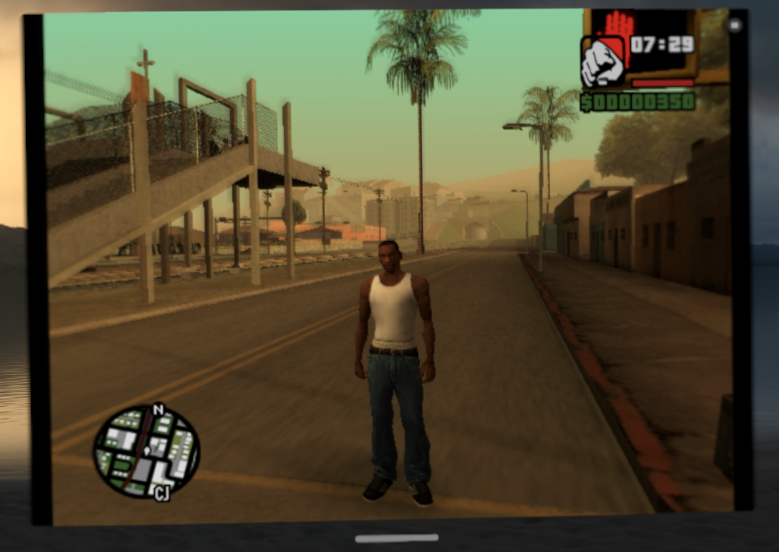

# JIT

**JIT that works on current chips.** iOS 26 on A15 and M2 and later, and visionOS 27 on
Vision Pro, no longer let an app run code it generates just because a debugger attached once
and set `CS_DEBUGGED`. That old trick is what SideStore's JIT button still does, and why JIT
on Vision Pro looked impossible. **Launch with JIT** keeps the debugger attached and prepares
the memory the app asks for, on the device itself: ARMSX2's 305 MiB took about two seconds.
It speaks the JIT26 requests StikDebug defined (and UTM's own), so apps built for them work as
they are, at home or away from it through the companion. An app can also ask for JIT for
itself while it runs, with an `apparition://enable-jit?bundle-id=…&pid=…` link (the
`stikdebug://` link works too, so Madeira's Enable JIT button finds Apparition); Apparition
then stays its debugger until the app closes. A link without a `pid` launches the app anew
under the debugger, as StikDebug does. One with a StikDebug JIT script (`script-data`, as
LiveContainer sends) runs the script as the app's debugger, after asking you: a script can
read and change everything in the app. On iPhone and iPad it keeps running in the
background by keeping coarse location updates on, which it drops unread: allow location
while using the app when asked. From a computer,
`apparition jit <bundle ID> [--attach]` does the same, and `apparition launch <bundle ID>
--jit --console` launches with JIT, the app's console and environment variables in one go,
which is how the [Apparition Store](STORE.md)'s **JIT**
deploy option and `apparition build --jit` launch a fresh build. Tested on Vision Pro with UTM (an
Alpine VM) and ARMSX2, the PS2 emulator, running GTA San Andreas
([video](https://youtu.be/mNR0ik2QfEY)).

## What JIT needs

**JIT needs no particular computer.** Apparition on the device is the app's debugger. It only
needs a way back to the device's own services, which the device won't connect to directly: a
companion on any computer (macOS, Windows or Linux) bounces that connection back, or LocalDevVPN
on iPhone, iPad and Vision Pro does it with no computer (it takes the device's only VPN slot, so
not alongside Tailscale). Apple TV can run VPN apps, but LocalDevVPN has no Apple TV version, so it uses a companion. A computer is needed
once, to install Apparition.

**On an iPhone using cellular data, turn on Airplane Mode before enabling JIT.** Otherwise the launch fails with a
"RemotePairing connection" error, because the phone can't reach its own pairing service. The failed-JIT alert says so.
This comes before the disk image check, so the image's download offer only appears once the connection works.

### Prepare the iPhone or iPad developer image

The debugger and location simulation use Apple's **Developer Disk Image**, which a restart
unmounts. Apparition gets it from, in order:

1. **Xcode on a Mac.** Xcode installs Apple's image in `/Library/Developer/DeveloperDiskImages`
   when it finishes its first launch (it ships inside Xcode, in `XcodeSystemResources.pkg`).
   During an Apparition install or `apparition pairing hand-off --device <name>`, the installer
   copies the personalized iOS image into Apparition on the device. After that, on-device JIT mounts
   it when needed without reaching the computer. Apple may still need to personalize it over the
   internet. Desktop JIT and location simulation use the same source to mount the image first.
2. **The paired Mac, from Windows or Linux.** Run `apparition mac pair <address>` and approve
   developer access in Apparition on the Mac, and keep Apparition running there during the install
   or hand-off. The PC fetches the image over the encrypted companion connection.
3. **A download from github.com, only if you allow it.** With no Xcode image, Apparition says why
   and offers to download Xcode's image (about 18 MB) from the public
   [doronz88/DeveloperDiskImage](https://github.com/doronz88/DeveloperDiskImage) mirror. Nothing is
   downloaded without your yes: the command line asks (or takes `--allow-ddi-download` where there
   is nobody to ask), the desktop app shows a button after the install, and on the device it is
   Settings › Developer Disk Image, or the **Download and Enable JIT** button on the failed-JIT alert, which
   starts the launch again once the image is in. Swipe the Settings row to delete a downloaded copy. The download is kept and checked
   against its own manifest each time. Apple's servers sign the image for your device before it mounts,
   so a changed file is refused.

`apparition ddi` says which of these a hand-off or JIT from this computer would use. On a Mac with no Xcode, install [Xcode from the Mac App Store](https://apps.apple.com/app/xcode/id497799835)
and open it once (or run `sudo xcodebuild -runFirstLaunch`), or use the download. If you need an older Xcode
that runs on your Mac, use [Apple Developer Downloads](https://developer.apple.com/download/all/?q=Xcode).
Repeat the pairing handoff after updating Xcode or the device's iOS, so the device's copy stays current.

The on-device mount uses the personalized image format, which needs a matching hardware
identity in Xcode's manifest. If Xcode only has a compatible cryptex image for your device,
prepare the device with Xcode.
