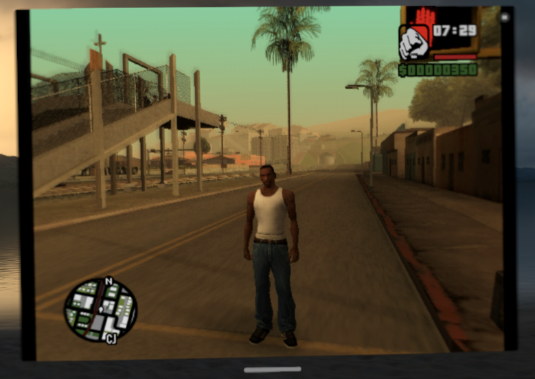

# JIT

**JIT that works on current chips.** iOS 26 on A15 and M2 and later, and visionOS 27 on
Vision Pro, no longer let an app run code it generates just because a debugger attached once
and set `CS_DEBUGGED`. That old trick is what SideStore's JIT button still does, and why JIT
on Vision Pro looked impossible. **Launch with JIT** keeps the debugger attached and prepares
the memory the app asks for, on the device itself: ARMSX2's 305 MiB took about two seconds.
It speaks the JIT26 requests StikDebug defined (and UTM's own), so apps built for them work as
they are, at home or away from it through the companion. An app can also ask for JIT for
itself while it runs, with an `apparition://enable-jit?bundle-id=…&pid=…` link (the
`stikdebug://` link works too, so Madeira's Enable JIT button finds Apparition); Apparition
then stays its debugger until the app closes. A link without a `pid` launches the app anew
under the debugger, as StikDebug does. One with a StikDebug JIT script (`script-data`, as
LiveContainer sends) runs the script as the app's debugger, after asking you: a script can
read and change everything in the app. On iPhone and iPad it keeps running in the
background by keeping coarse location updates on, which it drops unread: allow location
while using the app when asked. From a computer,
`apparition jit <bundle ID> [--attach]` does the same, and `apparition launch <bundle ID>
--jit --console` launches with JIT, the app's console and environment variables in one go,
which is how the [Apparition Store](STORE.md)'s **JIT**
deploy option and `apparition build --jit` launch a fresh build. Tested on Vision Pro with UTM (an
Alpine VM) and ARMSX2, the PS2 emulator, running GTA San Andreas
([video](https://youtu.be/mNR0ik2QfEY)).

## What JIT needs

**JIT needs no particular computer.** Apparition on the device is the app's debugger. It only
needs a way back to the device's own services, which the device won't connect to directly: a
companion on any computer (macOS, Windows or Linux) bounces that connection back, or LocalDevVPN
on iPhone, iPad and Vision Pro does it with no computer (it takes the device's only VPN slot, so
not alongside Tailscale). Apple TV has no VPN app, so it uses a companion. A computer is needed
once, to install Apparition.
